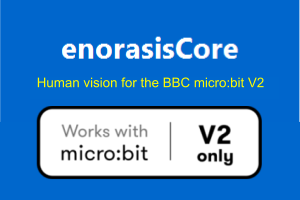

# enorasis-core



**Human vision for the BBC micro:bit V2.** Connect browser-based machine learning to your MakeCode projects.

> **This extension requires the micro:bit V2 hardware.** micro:bit V2 has more RAM available for user programs when Bluetooth is enabled. On a micro:bit V1 the program will display the **927** error code.

Train image classes in [enorasisCore](https://enorasiscore.eu) (nothing to install). When the AI recognises what the camera sees, it sends a **class label** to your micro:bit over **Bluetooth** or over the **USB cable**. Your blocks turn that label into action: servos, motors, LEDs and logic.

| | |
|---|---|
| **Product** | [enorasiscore.eu](https://enorasiscore.eu) |
| **License** | [MIT](LICENSE.txt) |
| **Board** | BBC micro:bit **V2** only |
| **Install** | `https://github.com/skinformatics/enorasisCore-makecode` |
| **Languages** | English, Greek, German, French, Spanish, Italian, Portuguese (Brazil), Dutch |

---

## Educational purpose

The micro:bit is excellent for physical computing, but it cannot **see** objects the way people do. This extension closes that gap for schools:

1. A **camera** (phone or computer) captures the world.
2. **Machine learning** in the browser (enorasisCore) classifies images into classes you define.
3. **Bluetooth** or the **USB cable** delivers the class name to the micro:bit.
4. **MakeCode blocks** (this extension) run your response.

The neural network runs in the **browser**, not on the micro:bit, which keeps projects fast, simple and suitable for classrooms. Students follow the full STEM path: **data, training, inference, action**.

This pattern matches many real systems: smart sensing on a capable device, control on a small board.

---

## How it works

```
  Camera          enorasisCore (browser ML)        micro:bit V2
 ┌────────┐       ┌─────────────────────┐         ┌──────────────┐
 │ image  │ Train │ classify, label     │ BLE or  │ your blocks  │
 │ input  │ Test  │ e.g. "left", "red"  │ USB ──► │ servo, LED…  │
 └────────┘       └─────────────────────┘         └──────────────┘
```

Everything you need is in the **EnorasisCore** category. You do not need blocks from the Bluetooth or Serial categories.

---

## Install

1. Open [makecode.microbit.org](https://makecode.microbit.org/).
2. Create a **New Project**.
3. Open **Extensions**.
4. Search for `enorasis-core`, or paste `https://github.com/skinformatics/enorasisCore-makecode`.
5. Select **enorasis-core**.
6. Build your program, **Download** the `.hex` and flash the micro:bit.

The extension sets **No Pairing Required** for Bluetooth automatically (from version 0.1.8), so there is nothing to change in Project Settings. If an older project was set to another pairing mode, MakeCode reports a settings conflict: open **Project Settings**, choose **No Pairing Required** and download again.

---

## Connect from enorasisCore

1. Train your classes at [enorasiscore.eu](https://enorasiscore.eu) in **Chrome** or **Edge**.
2. Go to the **Test & board** step and choose **BBC micro:bit V2**.
3. Press **Connect over Bluetooth** and select your micro:bit, or press **Connect by USB cable** and select its port.
4. With the camera on, every recognised class is sent to the micro:bit and your blocks run.

**Bluetooth** works on computers, tablets and Android phones. Do not pair the micro:bit in the system Bluetooth settings; connect only from enorasisCore.

**USB cable** works in Chrome or Edge on a computer (Windows, macOS, Linux, ChromeOS). Use a cable that carries data, and close the MakeCode tab or any serial monitor that is connected to the micro:bit.

---

## Blocks reference

### Start

| Block | Description |
|-------|-------------|
| `start enorasisCore over (Bluetooth and USB)` | Starts receiving class labels. Choose **Bluetooth and USB**, **Bluetooth only** or **USB cable only**. Shows a square icon when ready. |

### Classes

| Block | Description |
|-------|-------------|
| `on enorasisCore class received` | Runs when **any** class label arrives. |
| `on enorasisCore class (left) received` | Runs when a **specific** class label arrives. |
| `last enorasisCore class` | The last label received (text). |
| `enorasisCore class is (left)` | `true` when the last label equals the given name. |

### Connection

| Block | Description |
|-------|-------------|
| `on enorasisCore connected` | Runs when enorasisCore connects, over Bluetooth or the USB cable. Shows a check mark. |
| `on enorasisCore disconnected` | Runs when the connection ends. Shows an X. |
| `enorasisCore connected` | `true` while enorasisCore is connected. |
| `enorasisCore connection` | `"Bluetooth"`, `"USB"`, or empty when not connected. |

### Send

| Block | Description |
|-------|-------------|
| `send to enorasisCore (hello)` | Sends a short message from the micro:bit to the browser. enorasisCore shows it in the board card. |

Each block has a help page in the `docs/` folder.

---

## Examples

### Colours to servo

Train the classes `red`, `green` and `blue` in enorasisCore. Use the **same names** in MakeCode.

```blocks
enorasisCore.startWith(EnorasisLink.BluetoothAndUsb)
enorasisCore.onClassReceived("red", function () {
    pins.servoWritePin(AnalogPin.P0, 0)
    basic.showIcon(IconNames.Heart)
})
enorasisCore.onClassReceived("green", function () {
    pins.servoWritePin(AnalogPin.P0, 90)
})
enorasisCore.onClassReceived("blue", function () {
    pins.servoWritePin(AnalogPin.P0, 180)
})
```

### Direction arrows (classroom tested)

Train `left`, `right` and `nothing`.

```blocks
enorasisCore.startWith(EnorasisLink.BluetoothAndUsb)
enorasisCore.onClassReceived("left", function () {
    pins.servoWritePin(AnalogPin.P0, 0)
    basic.showArrow(ArrowNames.West)
})
enorasisCore.onClassReceived("right", function () {
    pins.servoWritePin(AnalogPin.P0, 180)
    basic.showArrow(ArrowNames.East)
})
enorasisCore.onClassReceived("nothing", function () {
    pins.servoWritePin(AnalogPin.P0, 90)
})
```

### Any class with a condition

```blocks
enorasisCore.startWith(EnorasisLink.BluetoothAndUsb)
enorasisCore.onAnyClassReceived(function () {
    if (enorasisCore.classIs("stop")) {
        basic.showIcon(IconNames.No)
    }
})
```

### Talk back to the browser

```blocks
enorasisCore.startWith(EnorasisLink.UsbOnly)
input.onButtonPressed(Button.A, function () {
    enorasisCore.send("A pressed")
})
enorasisCore.onConnected(function () {
    enorasisCore.send("ready")
})
```

---

## Protocol

For teachers and developers who want to connect other software.

- Each message is a UTF-8 **class name** followed by a newline (`\n`).
- **Bluetooth:** Nordic UART service. **USB cable:** serial port at 115200 baud.
- Lines that start with `#` are control messages from enorasisCore and never reach your blocks, so do not start a class name with `#`:
  - `#hello`: the micro:bit answers `ok enorasisCore microbit` over the cable, so enorasisCore can confirm that the program is running.
  - `#ping`: sent every 2 seconds over the cable. If no line arrives for 5 seconds, the cable connection counts as ended.
  - `#bye`: sent when the user disconnects the cable connection.
- The extension uses `serial.onDataReceived` for new lines. Avoid adding another serial handler for new lines in the same project.

---

## Updating from an older version

Open your project, go to **Extensions** and update **enorasis-core** when MakeCode offers it, or remove the extension and add it again. Your blocks keep working: the older `start enorasisCore` block still runs and now listens over Bluetooth and the USB cable.

---

## Version history

| Version | Changes |
|---------|---------|
| 0.1.8 | `start enorasisCore over (Bluetooth and USB)` with a choice of connection. Connect and disconnect events for the USB cable too. New blocks: `enorasisCore connected`, `enorasisCore connection`, `send to enorasisCore`. No Pairing Required is set automatically. Block groups. Translations in the MakeCode format, with tooltips. |
| 0.1.7 | Class labels over the USB cable. First translations. |
| 0.1.6 | New icon. |
| 0.1.5 | micro:bit V2 memory note, help page paths, icon address. |
| 0.1.4 | V2-only branding, help pages, tooltips. |
| 0.1.3 | First approved version for the MakeCode extension gallery. |

---

## Dependencies

- `core` (micro:bit)
- `bluetooth` (UART service, included automatically)

---

## Author

[Athanasios Kountourgiotis](https://enorasiscore.eu), enorasisCore browser machine learning platform.

MIT License. See [LICENSE.txt](LICENSE.txt).

```package
enorasis-core=github:skinformatics/enorasisCore-makecode
```

#### Metadata (used for search, rendering)

* for PXT/microbit
